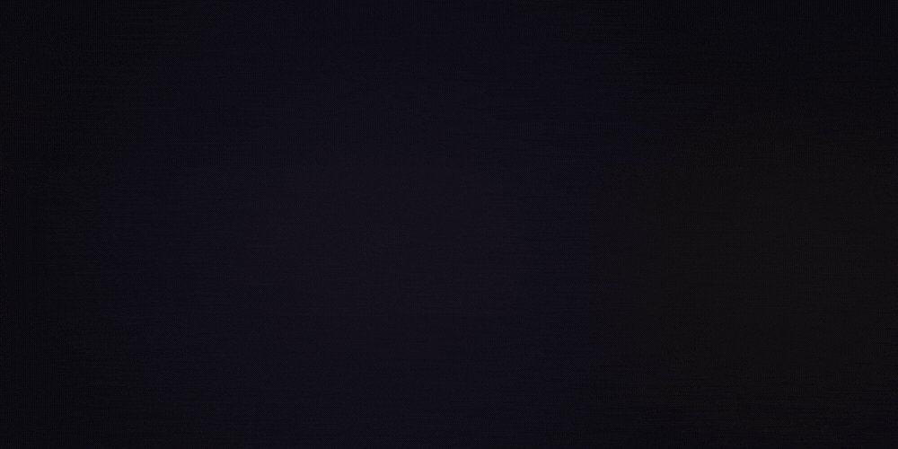

<div align="center">

# MyCNN

**A convolutional image classifier written from scratch in PyTorch.**<br>
100×100 grayscale images in, scores over 20 classes out.




<sub>The layer shapes are the real ones from <code>architecture.py</code>; the input image and the scores are illustrative.</sub>

</div>

---

## Architecture

| Stage | Layers | Output |
|---|---|---|
| Input | grayscale image | 1 × 100 × 100 |
| Block 1 | Conv 3×3 (64) → ReLU → MaxPool 2 → BatchNorm | 64 × 50 × 50 |
| Block 2 | Conv 3×3 (128) → ReLU → MaxPool 2 → BatchNorm → Dropout 0.4 | 128 × 25 × 25 |
| Block 3 | Conv 3×3 (256) → ReLU → MaxPool 2 → BatchNorm | 256 × 12 × 12 |
| Block 4 | Conv 3×3 (512) → ReLU → MaxPool 2 → BatchNorm | 512 × 6 × 6 |
| Head | Global average pool → Linear 512 → ReLU → Dropout 0.5 → Linear 20 | 20 scores |

1,824,660 trainable parameters. Global average pooling keeps the head small: most parameters sit in the last conv block (1.18M), not in the classifier.

## Data pipeline

`dataset.py` reads a folder of `.jpg` images plus one `.csv` (semicolon-separated, header row, `filename;classname`) and returns `(image, class_id, class_name, path)`.

- **Grayscale done properly:** RGB is converted to linear light, weighted with the Rec. 709 luminance coefficients (0.2126, 0.7152, 0.0722), then gamma-encoded back, rather than averaging the channels.
- **Fixed size without distortion:** images are centre-cropped or edge-padded to 100 × 100, never stretched.
- **Normalised** to [0, 1].

## Augmentation

`utils.DataTransforms` defines four training pipelines, so the model sees each image under different distortions:

| Pipeline | What it varies |
|---|---|
| 1 | horizontal flip, rotation ±30°, random crop with padding |
| 2 | vertical flip, affine (rotate, translate, scale, shear), colour jitter |
| 3 | rotation ±45°, Gaussian blur, random resized crop |
| 4 | random grayscale, affine, additive Gaussian noise (σ 0.5) |

## Use it

```python
import torch
from torch.utils.data import DataLoader
from architecture import MyCNN
from dataset import ImagesDataset
from utils import evaluate_model

device = torch.device("cuda" if torch.cuda.is_available() else "cpu")
data = ImagesDataset("path/to/images", width=100, height=100)
loader = DataLoader(data, batch_size=64)

model = MyCNN().to(device)
loss, accuracy = evaluate_model(model, loader, torch.nn.CrossEntropyLoss(), device)
print(f"loss {loss:.3f} · accuracy {accuracy:.1f}%")
```

## Files

| File | Contents |
|---|---|
| [`architecture.py`](architecture.py) | `MyCNN` |
| [`dataset.py`](dataset.py) | `ImagesDataset`, grayscale conversion, crop/pad to size |
| [`utils.py`](utils.py) | `evaluate_model`, noise helpers, the four augmentation pipelines |

<sub>The animation at the top is drawn frame by frame in code (canvas → headless Chromium → ffmpeg): <a href="https://github.com/omarjku/omarjku/tree/main/motion">source</a>.</sub>
